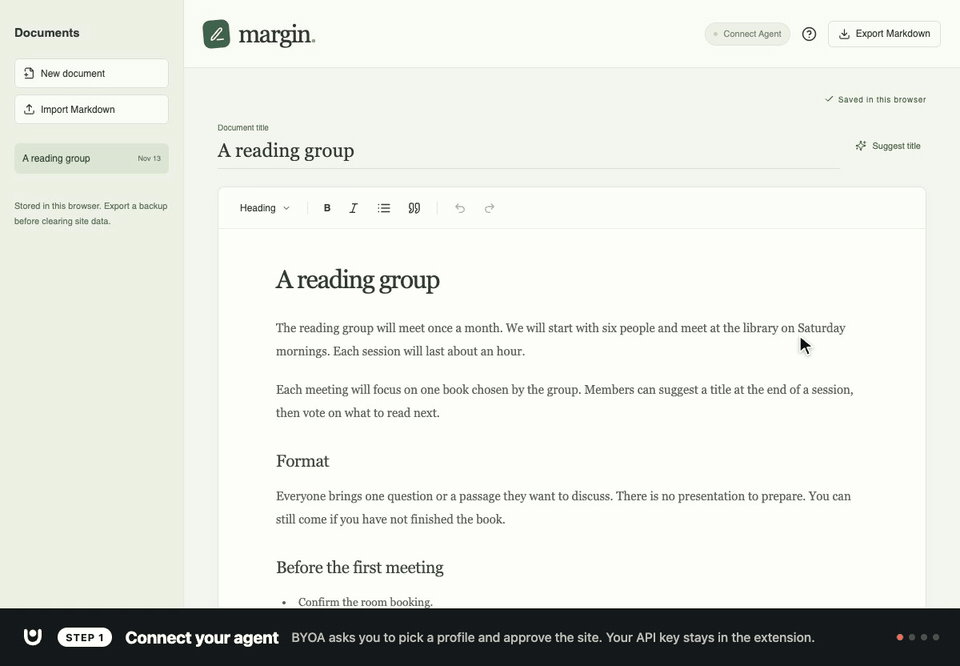

# Bring Your Own Agent (BYOA)



Configure your agent once in a browser extension. Connect an app, send a request from inside it, and review the results there. The extension runs the agent in the background; its sidebar is optional.

[Watch the demo on YouTube](https://www.youtube.com/watch?v=2dbfm2v9eKE)

This repo contains the BYOA browser extension (a modified AgentBoard), the SDK packages that add BYOA to a web app, and two WebMCP demos:

| Folder                | What it does                                                                                                                                                                                             |
| --------------------- | -------------------------------------------------------------------------------------------------------------------------------------------------------------------------------------------------------- |
| `byoa-extension/`     | Our AgentBoard fork: provider configuration, background tasks, scoped page tools, cancellation, and optional chat transcripts. The extension is branded BYOA; internal identifiers retain compatibility. |
| `packages/react/` | Optional React components and hooks: the same connection dialog as the custom element, plus request and status UI. |
| `packages/browser/` | The SDK for any web app: connection and request client, the `<byoa-connection-dialog>` custom element, shared styles, and the coding-agent recipes. |
| `demos/margin/`       | Selection-first writing app with inline suggestions and comments. Port 5183.                                                                                                                             |
| `demos/boardwalk/`    | Kanban board with reviewable card and column changes. Port 5184.                                                                                                                                         |

## Add BYOA to your app with a coding agent

Point your coding agent at the recipe. It works in any web app (React or not) and walks the agent through everything: surveying the app, choosing or creating the WebMCP tools (it stops for your approval before creating any), installing the SDK, adding the **Connect Agent** button and dialog, wiring one request, and testing with a mock provider.

```text
Add Bring Your Own Agent (BYOA) to this app. Follow this recipe step by step:
https://raw.githubusercontent.com/adamgoth/bring-your-own-agent/main/packages/browser/prompts/add-byoa.md
```

The recipe is [add-byoa.md](packages/browser/prompts/add-byoa.md); it hands off to [add-webmcp-tools.md](packages/browser/prompts/add-webmcp-tools.md) when the app needs tools. Both are also shipped in the browser package under `prompts/`.

The SDK isn't on npm yet. The agent builds it from this repository with one command that installs only the two packages and writes their archives into the app:

```sh
pnpm sdk:vendor --out /absolute/path/to/your-app/vendor/byoa
```

Then it installs `./vendor/byoa/byoagent-browser-0.1.0.tgz` (plus `byoagent-react-0.1.0.tgz` for React apps) and commits them with the app's lockfile. To use the result, people need the [BYOA extension](#install-the-extension).

See the [browser SDK](packages/browser/README.md) (any framework, including the `<byoa-connection-dialog>` element), [React components and styling](packages/react/README.md), and [the integration guide](docs/web-app-integration.md).

## Install the extension

BYOA isn't in the Chrome Web Store yet, so build it from this repository (Node 22.13+ and pnpm 10.28):

```sh
git clone https://github.com/adamgoth/bring-your-own-agent.git
cd bring-your-own-agent/byoa-extension
pnpm install --frozen-lockfile
pnpm build
```

Open `chrome://extensions`, turn on Developer mode, choose **Load unpacked** and select `byoa-extension/dist`. In BYOA's Options, add an agent profile with your provider, model and API key. Then open a BYOA-enabled app and click **Connect Agent**.

## Get running

Use Node 22.13+ and pnpm 10.28.0 (npm ships with Node).

```sh
cd bring-your-own-agent
pnpm run setup
pnpm build
pnpm dev:demos
```

`pnpm run setup` installs each project's pinned dependencies using its existing lockfile. The projects keep independent lockfiles; this is a single project folder, not a pnpm workspace. No provider credentials or browser profiles are part of the repo.

1. Open `chrome://extensions`, enable Developer mode, and **Load unpacked** → this repo's `byoa-extension/dist` folder.
2. Configure your API agent profiles in the extension's Options.
3. Open [Margin](http://localhost:5183/) and [Boardwalk](http://localhost:5184/). Both `localhost` and `127.0.0.1` work; each origin needs its own connection approval.
4. In each app, choose **Connect Agent** in the header, then **Connect Agent** in the dialog. BYOA opens its own popup: check the requesting site, select a profile, then approve. The picker is shown even when only one profile exists. The header displays your agent's profile name.
5. Send a request inside the app. Proposals appear there for review. **Open in sidebar** explicitly opens the extension's task transcript.

Load only one BYOA installation while testing to avoid duplicate bridges on the same page. Keep settings exports private; they can contain credentials. Reload the extension and app tabs after extension rebuilds.

The servers bind to loopback and use strict ports. Ports 5183/5184 keep the demos separate from apps using Vite’s default port 5173. Ctrl+C stops both servers.

## Demo prompts

**Margin:** highlight a passage → Suggest replacement → “Make this clearer and more concise” → Send. Accept or reject the inline suggestion.

**Boardwalk:** select any card → Ask agent → “Break this into three actionable tasks. Keep the original card” → Send. Review the batch before accepting.

Also try: “Create a column called Next week, move two high-priority cards into it, rename Ready to Up next, and propose deleting the sample-board card.” Card deletion and column changes are proposals, not immediate mutations. Undo restores accepted cards and columns together. Editing the board invalidates older proposals.

`pnpm dev:demos` starts both demos together: Margin at http://localhost:5183/ and Boardwalk at http://localhost:5184/. `pnpm dev` is an equivalent shortcut. Press Ctrl+C to stop both.

## Shared contract

Apps expose their actions with WebMCP. They pass registered tool names to `byoa.request()` through the shared client; they never supply executable tool definitions to the provider interface. No app-specific extension handler is needed.

- Margin: `get_selection`, `get_document_outline`, `find_text`, `propose_replacement`, `add_comment`.
- Boardwalk: `get_board_snapshot`, `get_selected_cards`, `propose_board_changes` (card create/update/move/delete; column create/rename).

The SDKs are packaged locally as `@byoagent/browser` and `@byoagent/react` (no npm publication in this change). Use `pnpm sdk:vendor --out /path/to/app/vendor/byoa` to build both archives into an app (or `pnpm pack:sdk` to also verify them in fresh consumer installs), then install them with relative paths. Import `{ byoa }` from `@byoagent/browser`; the deprecated `agentboard` alias still works. See the [neutral provider spec](docs/provider-spec.md) for discovery, provider selection, security and use without the SDK.

To build BYOA into a web app, start with the [web app integration guide](docs/web-app-integration.md). See [the SDK contract](packages/browser/README.md) for the client API, and [Margin's guide](demos/margin/README.md) and [Boardwalk's guide](demos/boardwalk/README.md) for worked examples.

This is a prototype. Any HTTPS site, and `localhost`/`127.0.0.1` on any port, can ask to connect; nothing is shared until you approve that exact origin in BYOA's popup. Connections are per origin, lasting until the browser closes by default, for 30 days, or until you disconnect; page tasks run independently of sidebar chats (up to 3 globally, 2 per profile, and 1 per tab), with separate limits of five minutes queued, two minutes running by default (1–10 minutes in Options), and 60 seconds without progress. Apps may shorten the run limit. A dropped port can reattach within the same document for ten seconds; navigation and worker restarts stop the run, leaving session-only task summaries for lookup and an explicit Retry action. There is no automatic retry. BYOA owns the profile picker and site-approval popup. Person-controlled spending budgets and cumulative token reporting are available.

Provider API billing applies. This does not use a ChatGPT or Claude consumer subscription. Use sample content: the configured provider receives instructions, tool definitions, and tool results. Workspace sharing is off by default. In BYOA’s popup, you can share read-only snapshots of Persona (IDENTITY.md and SOUL.md), About you (USER.md), or Memory (MEMORY.md) for that exact origin for the chosen connection duration. Shared content can reach destinations used by the site’s tools. AGENTS.md, journals, file tools, and remote-MCP context remain excluded. The page API exposes no sharing state. Credentials remain in the extension.

Manage approvals in **Options → Connected sites**: review shared files, change duration, disconnect one or all sites, and view or clear metadata-only activity. Disconnecting cancels running tasks. Incognito approvals stay session-only. Activity is kept locally for up to 30 days and 500 entries; grants and activity are excluded from settings backups.

## Checks

```sh
pnpm check       # Extension types/lint/tests; both demo unit tests and builds
pnpm check:sdk   # Pack/install consumer types and SSR import
pnpm build       # Build the extension and both demos
# Keep pnpm dev running in a separate terminal, then:
CHROME_FOR_TESTING_BIN='/path/to/Chrome for Testing' pnpm test:browser
```

The browser test uses a fresh temporary profile and a loopback mock model provider. It verifies both apps, distinct tool scopes, review/acceptance, deletion and column changes, concurrent app tasks and sidebar isolation, cancellation, per-origin disconnect, optional task transcripts, and mobile layout. It does not use your normal browser profile or real API credentials. Margin also has its own editor Playwright regressions: `npm --prefix demos/margin run test:e2e` (requires Google Chrome and the dev server).

## Source and licensing

BYOA builds on [AgentBoard](https://github.com/igrigorik/agentboard) by [Ilya Grigorik](https://github.com/igrigorik). The original MIT license and copyright notice are preserved in [byoa-extension/LICENSE](byoa-extension/LICENSE). See [attribution details](PROVENANCE.md).

GitHub Actions runs from the root `.github/workflows/ci.yml`, checking all three projects and their browser integration. The upstream WebMCP WPT suite remains an opt-in workflow diagnostic because known conformance gaps remain; requested diagnostic runs still fail on those gaps.
