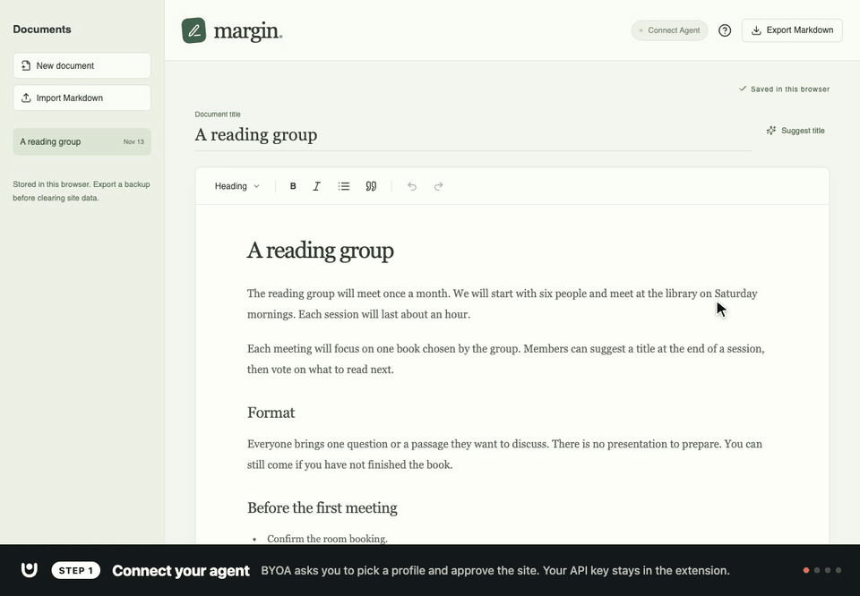
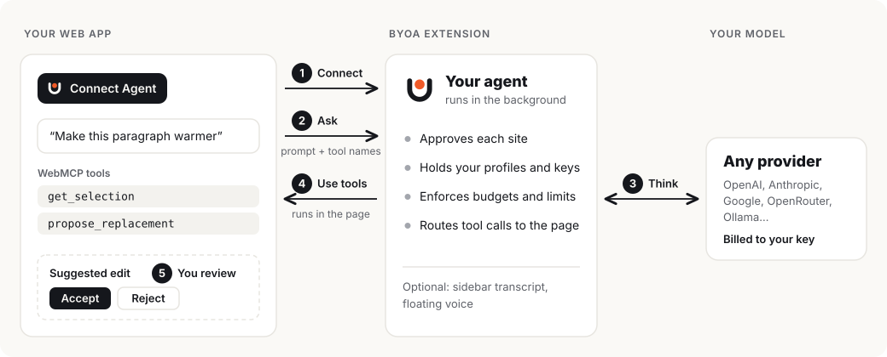

# Bring Your Own Agent (BYOA)

BYOA lets you use your own AI agent inside any web app that supports it, instead of whatever AI the app has built in.

**[Install BYOA from the Chrome Web Store](https://chromewebstore.google.com/detail/byoa/blejfcpiehehleecegkoapjfngcijhhp)**



Configure your agent once in the BYOA browser extension: your provider, your model, your API key. When an app supports BYOA, click **Connect Agent**, approve the site, and ask for work from inside the app. The agent runs in the background and its results show up in the app for you to review.

[Watch the demo on YouTube](https://www.youtube.com/watch?v=2dbfm2v9eKE)

## How it works

<picture>
  <source media="(prefers-color-scheme: dark)" srcset="docs/media/how-it-works-dark.svg">
  
</picture>

The app registers its actions (read the selection, propose an edit) as [WebMCP](https://github.com/webmachinelearning/webmcp) tools in the page. Then:

1. **Connect.** You click **Connect Agent** in the app. BYOA opens its own window where you approve that exact site and pick an agent profile. The app never sees your keys or your other profiles.
2. **Ask.** The app sends a prompt and the names of the tools the agent may use.
3. **Think.** BYOA runs your agent in the background on your model provider, with your key.
4. **Use tools.** When the agent calls a tool, BYOA routes the call back to the page, where the app's own code runs it.
5. **You review.** The app shows what the agent proposed, and you accept, reject or undo.

The sidebar is optional: tasks run without it, and you can open a task's transcript there when you want to see what the agent did.

| Piece | Owns |
| --- | --- |
| The app | Its interface, state, tools, validation, and the review and undo flow. |
| WebMCP | The in-page registry of tool names, schemas and execution functions. |
| BYOA SDK | The connection and request client, plus optional connection and prompt UI. |
| BYOA extension | Agent profiles and credentials, site approval, model requests, budgets, progress and cancellation. |

## Features

**For people using BYOA-enabled apps**

- **Any model.** OpenAI-style (Responses or Chat Completions), Anthropic, Google, OpenRouter, a compatible proxy, or local Ollama.
- **Multiple agent profiles.** Choose which one each site gets when you connect.
- **Per-site approval.** Nothing is shared until you approve the exact origin, for the browser session, 30 days, or until you disconnect.
- **Spending budgets.** A token cap per task, plus daily token or dollar caps per site and across all sites.
- **Connected sites.** Review what each site can use, change its duration, disconnect it, and see a local metadata-only activity log.
- **Background work.** Tasks run without the sidebar, up to three at once. Open a task's transcript only when you want it.
- **Optional context sharing.** Share read-only persona, about-you or memory files from a local workspace with a site. Off by default.
- **Floating voice (beta).** Dictate a request on sites that opt in. Speech is transcribed on your device.
- **A sidebar agent for any page.** Chat with page tools for reading pages, PDFs, GitHub pull requests and YouTube transcripts; connect remote MCP servers; script your own WebMCP tools; save prompt commands. See the [extension README](byoa-extension/README.md).

**For app developers**

- **Browser SDK** (`@byoagent/browser`). Connect, request work, stream progress, cancel and look up tasks from any framework. ESM and SSR-safe.
- **Drop-in connection UI.** A `<byoa-connection-dialog>` custom element, or React components and hooks (`@byoagent/react`), themed with `--byoa-*` CSS variables.
- **Coding-agent recipes.** Point your coding agent at one prompt and it adds BYOA to your app, including the WebMCP tools.
- **Your tools stay yours.** Apps expose actions through WebMCP and pass tool names. The extension needs no app-specific code.
- **Task lifecycle.** Queued, working and terminal events, token usage, timeouts, and recovery after a reload with an explicit retry.
- **Voice opt-in.** One call (`configureVoice`) adds the extension-owned microphone to your connected app.
- **Open provider protocol.** Discovery and requests work [without the SDK](docs/provider-spec.md), and other providers can implement the same interface.
- **Worked examples.** [Margin](demos/margin/README.md), a writing app, [Boardwalk](demos/boardwalk/README.md), a Kanban board, and [Piano Tutor](demos/piano-tutor/README.md), a voice-driven app with no backend.

**Safety model**

- Credentials stay in the extension and never reach the page.
- A site task gets only the page tools the app named, never your sidebar tools, files or remote MCP servers.
- Connecting and requesting work need a real click from you.
- Both demos apply changes as proposals you review, with stale-proposal checks and undo. That pattern is the recommended one for any app.
- BYOA has no account, telemetry or proxy. Your prompts and tool results go to the provider you configured.

## Install the extension

Install [BYOA from the Chrome Web Store](https://chromewebstore.google.com/detail/byoa/blejfcpiehehleecegkoapjfngcijhhp). In BYOA's Options, add an agent profile with your provider, model and API key. Then open a BYOA-enabled app and click **Connect Agent**.

### Build from source

To work on the extension itself, build it from this repository (Node 22.13+ and pnpm 10.28):

```sh
git clone https://github.com/adamgoth/bring-your-own-agent.git
cd bring-your-own-agent/byoa-extension
pnpm install --frozen-lockfile
pnpm build
```

Open `chrome://extensions`, turn on Developer mode, choose **Load unpacked** and select `byoa-extension/dist`. Disable the store version while you test the local build, so only one BYOA installation runs.

Reload the extension and app tabs after a rebuild.

## Run the demos

From the repository root, with the extension loaded:

```sh
pnpm run setup
pnpm build
pnpm dev:demos
```

This starts [Margin](http://localhost:5183/) on port 5183 and [Boardwalk](http://localhost:5184/) on port 5184. Ctrl+C stops both. `pnpm run setup` installs each project from its own lockfile; the repository is a single folder of independent projects, not a pnpm workspace.

1. In each app, choose **Connect Agent** in the header, then **Connect Agent** in the dialog.
2. In BYOA's popup, check the requesting site, select a profile and approve. The header then shows your profile's name.
3. Send a request inside the app and review what comes back. **Open in sidebar** shows the task transcript.

Things to try:

- **Margin:** highlight a passage → **Improve this** → "Make this clearer and more concise" → **Suggest edit**. Accept or reject the inline suggestion.
- **Boardwalk:** select a card → **Ask agent** → "Break this into three actionable tasks. Keep the original card" → **Send**. Review the batch before accepting.
- **Boardwalk, bigger:** "Create a column called Next week, move two high-priority cards into it, rename Ready to Up next, and propose deleting the sample-board card." Everything arrives as one proposal, and **Undo** restores cards and columns together.

Both `localhost` and `127.0.0.1` work, but each origin needs its own approval. Use sample content: your provider receives the instructions, tool definitions and tool results.

## Add BYOA to your app

Point your coding agent at the recipe. It works in any web app (React or not) and walks the agent through everything: surveying the app, choosing or creating the WebMCP tools (it stops for your approval before creating any), installing the SDK, adding the **Connect Agent** button and dialog, wiring one request, and testing with a mock provider.

```text
Add Bring Your Own Agent (BYOA) to this app. Follow this recipe step by step:
https://raw.githubusercontent.com/adamgoth/bring-your-own-agent/main/packages/browser/prompts/add-byoa.md
```

The recipe is [add-byoa.md](packages/browser/prompts/add-byoa.md); it hands off to [add-webmcp-tools.md](packages/browser/prompts/add-webmcp-tools.md) when the app needs tools. Both also ship in the browser package under `prompts/`.

The SDK isn't on npm yet. The agent builds it from this repository with one command that installs only the two packages and writes their archives into the app:

```sh
pnpm sdk:vendor --out /absolute/path/to/your-app/vendor/byoa
```

Then it installs `./vendor/byoa/byoagent-browser-0.1.0.tgz` (plus `byoagent-react-0.1.0.tgz` for React apps) and commits them with the app's lockfile. To use the result, people need the [BYOA extension](#install-the-extension).

Doing it by hand, or want the detail?

| Doc | What it covers |
| --- | --- |
| [Web app integration guide](docs/web-app-integration.md) | Registering tools, connecting, requesting work, reviewable changes, testing. |
| [Browser SDK](packages/browser/README.md) | The client API and its contract, including the `<byoa-connection-dialog>` element. |
| [React components](packages/react/README.md) | Components, hooks, styling and accessibility. |
| [Provider protocol](docs/provider-spec.md) | Discovery, methods, errors and security, for use without the SDK. |
| [Limits, permissions and privacy](docs/limits-and-privacy.md) | Who can connect, approvals, task limits, budgets and data flow. |
| [Margin](demos/margin/README.md), [Boardwalk](demos/boardwalk/README.md), [Piano Tutor](demos/piano-tutor/README.md) | Worked examples. |

## What's in this repository

| Folder | What it does |
| --- | --- |
| `byoa-extension/` | The browser extension: agent profiles, site approval, background tasks, budgets, sidebar chat and voice. A fork of AgentBoard; some internal identifiers keep the old name for compatibility. |
| `packages/browser/` | The SDK for any web app: connection and request client, the `<byoa-connection-dialog>` custom element, shared styles, and the coding-agent recipes. |
| `packages/react/` | Optional React components and hooks over the browser SDK. |
| `demos/margin/` | Selection-first writing app with inline suggestions and comments. |
| `demos/boardwalk/` | Kanban board with reviewable card and column changes. |
| `demos/piano-tutor/` | Voice-driven piano tutor: shows chords and keys, listens to MIDI. No backend; BYOA's floating voice drives its tools. Port 5185. |
| `docs/` | Integration guide, provider protocol, limits, and design notes. |

## Status and limits

This is a prototype. Any HTTPS site, and `localhost` or `127.0.0.1` on any port, can ask to connect; nothing is shared until you approve that exact origin. Provider API billing applies, and BYOA does not use a ChatGPT or Claude consumer subscription.

Timeouts, concurrency, connection durations, budgets, workspace sharing and data flow are all in [Limits, permissions and privacy](docs/limits-and-privacy.md).

## Checks

```sh
pnpm check       # Extension types/lint/tests; both demo unit tests and builds
pnpm check:sdk   # Pack/install consumer types and SSR import
pnpm build       # Build the extension and both demos
# Keep pnpm dev running in a separate terminal, then:
CHROME_FOR_TESTING_BIN='/path/to/Chrome for Testing' pnpm test:browser
```

The browser test uses a fresh temporary profile and a loopback mock model provider. It verifies both apps, distinct tool scopes, review/acceptance, deletion and column changes, concurrent app tasks and sidebar isolation, cancellation, per-origin disconnect, optional task transcripts, and mobile layout. It does not use your normal browser profile or real API credentials. Margin also has its own editor Playwright regressions: `npm --prefix demos/margin run test:e2e` (requires Google Chrome and the dev server).

## Source and licensing

BYOA builds on [AgentBoard](https://github.com/igrigorik/agentboard) by [Ilya Grigorik](https://github.com/igrigorik). The original MIT license and copyright notice are preserved in [byoa-extension/LICENSE](byoa-extension/LICENSE). See [attribution details](PROVENANCE.md).

GitHub Actions runs from the root `.github/workflows/ci.yml`, checking all three projects and their browser integration. The upstream WebMCP WPT suite remains an opt-in workflow diagnostic because known conformance gaps remain; requested diagnostic runs still fail on those gaps.
